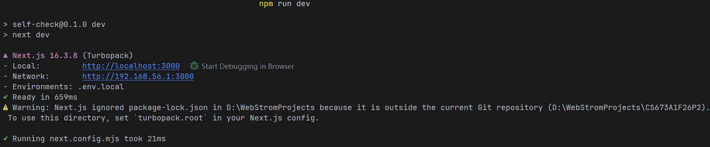
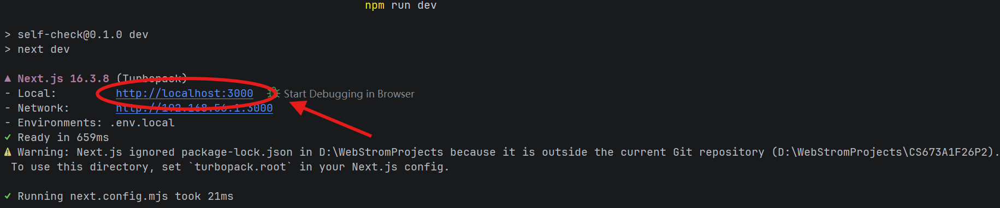
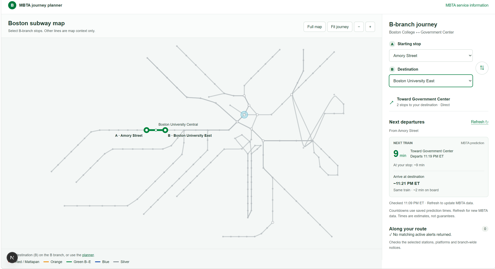

# MBTA Tracker
This is a [Next.js](https://nextjs.org) project bootstrapped with [`create-next-app`](https://nextjs.org/docs/app/api-reference/cli/create-next-app).

## Brief
This is a web app allow user to track the Massachusetts Bay Transportation Authority trains in great Boston area.
It provides a MBTA map, predictions and schedules of every stop of rails in real-time. The user can better arrange their time of commuting using this web app.
This app is built by Next.js with React.

## Setup

- **Node.js 22.x** — This is the version used by both stages of the project Dockerfile. Next.js requires Node.js 20.9.0 or newer.
- **npm with lockfile support** — Install the exact dependency versions from `package-lock.json` by running `npm ci`.
- **Next.js 16.3.8** — The application uses the App Router and Next.js server route handlers.
- **React 19.2.8 and React DOM 19.2.8** — These versions are pinned in `package.json`.
- **CSS tooling: PostCSS 8.5.23** — It is supplied by Next.js for the project's global CSS and CSS Modules; Tailwind CSS and Sass are not required.
- **ESLint 9 with eslint-config-next 16.3.8** — Required for running `npm run lint`.
- **MBTA API configuration** — Copy `.env.example` to `.env.local` and set `MBTA_API_KEY` to your MBTA V3 API key. The key is optional for basic access but recommended to reduce rate-limit errors.
- **Docker with Docker Compose v2 (optional)** — Required only for the containerized setup defined by `Dockerfile` and `docker-compose.yml`.

## Getting Started
### Run in the console
If you want to run it on your local machine with console, follow the steps below.
1. First, run the development server:
```bash
npm run dev
# or
yarn dev
# or
pnpm dev
# or
bun dev
```


2. Open [http://localhost:3000](http://localhost:3000) with your browser to see the result.



3. Then you can try the MBTA Tracker by yourself. You can start editing the page by modifying `app/page.js` or other files. The page auto-updates as you edit the file.


This project uses [`next/font`](https://nextjs.org/docs/app/building-your-application/optimizing/fonts) to automatically optimize and load [Geist](https://vercel.com/font), a new font family for Vercel.

### Run in Docker

1. Start Docker Desktop, open a terminal in the project directory, and confirm that Docker is available with `docker version` and `docker compose version`.

2. Build the images and start the web application and Nginx proxy with `docker compose up --build --detach`.

3. Open `http://127.0.0.1:8080` in your browser. When finished, stop and remove the project containers with `docker compose down`.

## Learn More
To learn more about Next.js, take a look at the following resources:

- [Next.js Documentation](https://nextjs.org/docs) - learn about Next.js features and API.
- [Learn Next.js](https://nextjs.org/learn) - an interactive Next.js tutorial.

You can check out [the Next.js GitHub repository](https://github.com/vercel/next.js) - your feedback and contributions are welcome!

To learn more about the MBTA API, go to the link below:
- [MBTA API Official Site](https://www.mbta.com/developers/v3-api) - Look for more details.You can also register your account to apply for a secure API key from MBTA.
- [MBTA V3 API Documentation](https://api-v3.mbta.com/docs/swagger/index.html) - You can find more endpoints and illustrations here for you might want to add more fancy features by yourself.

## How to deploy it on Vercel

The easiest way to deploy your Next.js app is to use the [Vercel Platform](https://vercel.com/new?utm_medium=default-template&filter=next.js&utm_source=create-next-app&utm_campaign=create-next-app-readme) from the creators of Next.js.

Check out our [Next.js deployment documentation](https://nextjs.org/docs/app/building-your-application/deploying) for more details.
